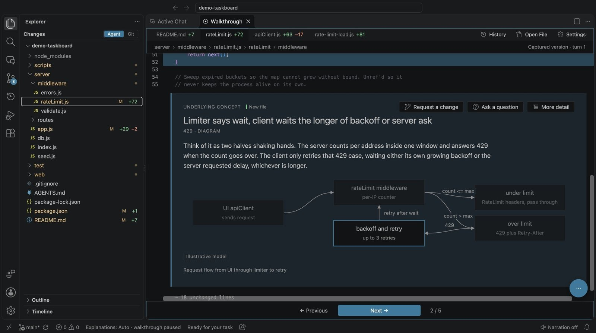
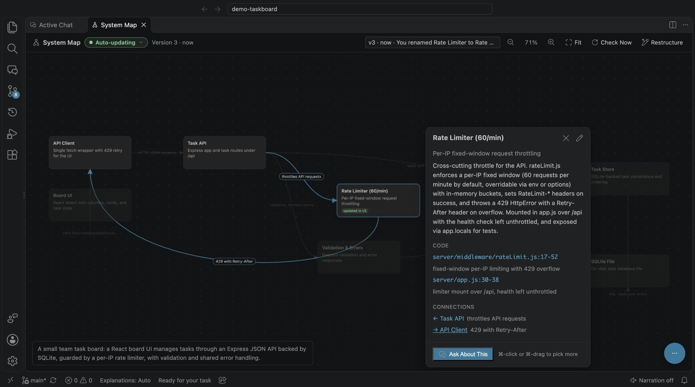
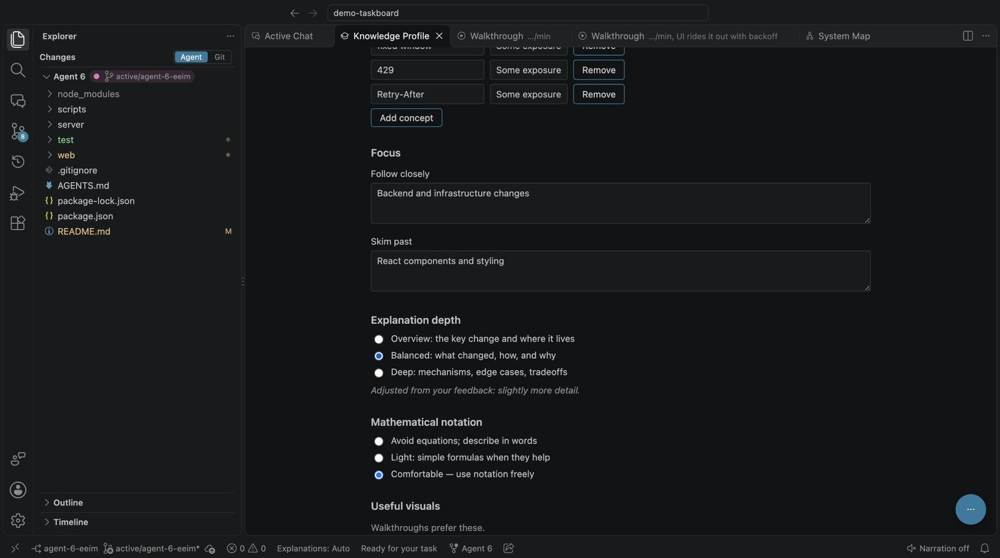
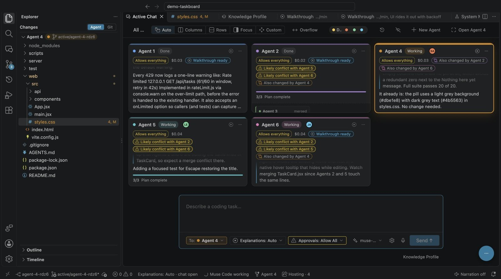

# Active

**Build at agent speed. Understand every step.**

Active is an IDE for working with coding agents without losing track of your own code. While the agent works, Active explains each meaningful change in a short walkthrough pitched at what you already know, keeps a live map of how the system fits together, and lets you run and steer several agents, alone or with your team.

Built this week for the Meta Global Hackathon, on top of [Code - OSS](https://github.com/microsoft/vscode), [Muse Code](https://github.com/meta-models/muse-code-sdk), Muse speech-to-text and Meta's [MMS](https://huggingface.co/facebook/mms-tts-eng) text-to-speech. Free and open source.

## Quick start

You need macOS, Xcode's command-line tools (`xcode-select --install`), Python 3.9+ (or `uv`) and about 12 GB of free disk space.

```sh
git clone <this repo> active && cd active
scripts/setup.sh                 # one time, about 15–30 minutes: Code - OSS, Node, narration, Active
scripts/run.sh /path/to/project  # open a project in Active
```

On first launch, Active walks you through anything that isn't ready: it installs Muse Code if needed, signs you in (Muse subscription or a Meta API key), and sets up your knowledge profile.

No Muse subscription? `scripts/run-scripted-demo.sh` opens Active on a sample project with a scripted stand-in for the coding agent.

## Understand



Give the agent a task in chat. When a piece of work is done, Active opens a walkthrough of the real code in the editor, one idea per scene, with diffs, diagrams, equations and charts drawn from what actually changed and ran. Read it at your own pace or turn on narration (MMS, on device). From any scene you can **Ask a question**, get **More detail**, or **Request a change** with that code as context.

## See the bigger picture



The **System Map** draws your project's parts and how they connect, and redraws as agents change the code. Click a part to see what it does and the code behind it, ask about it, rename it, drag it around, or ask for a restructure in plain words.

## Made for you



Your **Knowledge Profile** holds your background, what you know well, and what to follow closely or skim past. Walkthroughs adapt to it, and it keeps learning: tell Active a walkthrough had too much or too little detail and the next ones change. Active remembers what it has explained and what you asked, so it doesn't explain the same thing twice.

## Orchestrate and collaborate



- **Several agents at once.** **New Agent** starts another coding agent in its own git worktree. Agents can split work across subagents.
- **The agent grid.** Zoom out to see every agent at once, live. Rearrange and resize the boxes, switch layouts, and message any agent from the grid. The Explorer, search, terminals and open files follow whichever agent you pick.
- **Merging.** Drag one agent onto another to merge its work. Its work stays explained.
- **Collaborate.** Host a session and share an invite code. Teammates join as collaborators or viewers, see who is looking at which agent, and send work to your agents.

## And more

- **Dictation:** hold the mic to speak a task (Muse speech-to-text).
- **A debugger for the agent:** Muse can run tests under a real debugger with logpoints and breakpoints instead of adding print statements.
- **Code traces:** ask how a behaviour works and get the path through the code, checked by running it.
- **Away mode and Catch Me Up:** step away and come back to a short briefing of what every agent did.

## Learn more

[docs/reference.md](docs/reference.md) covers setup details, every feature, settings, the architecture, and how to run the tests.

## License

[MIT](License.txt). The MMS narration model is Meta's `facebook/mms-tts-eng`, under CC-BY-NC 4.0.
